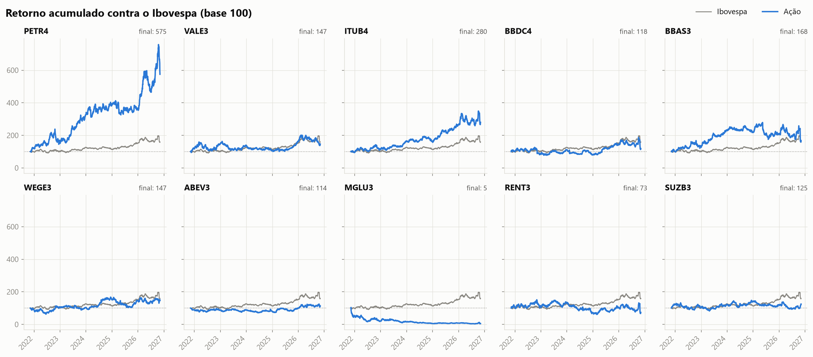
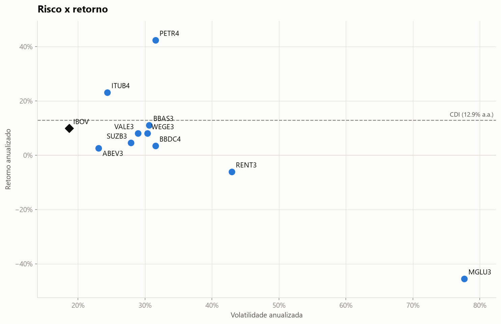
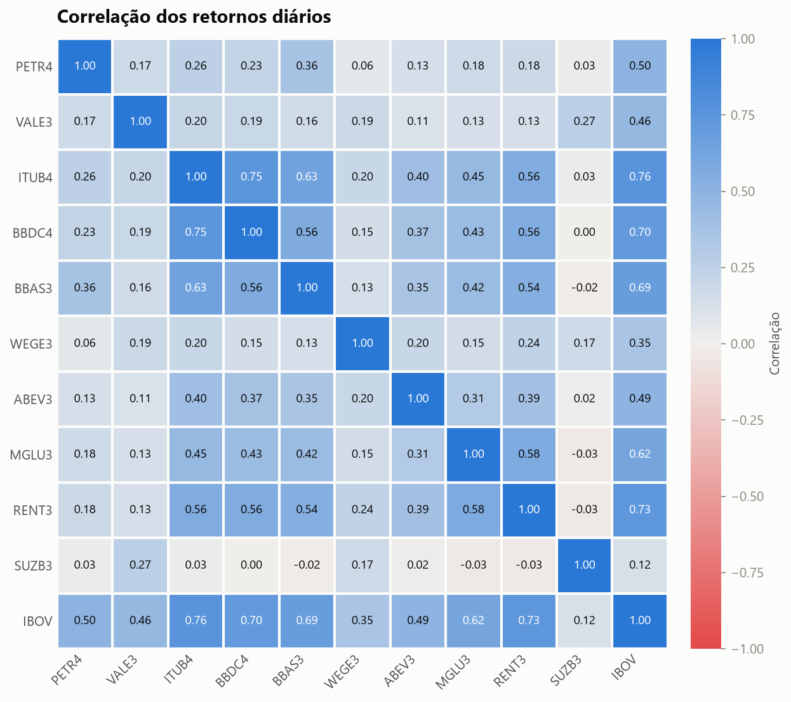

# sharpe-b3

Análise de rentabilidade e risco de 10 ações da B3, comparadas com o Ibovespa e com o CDI.

## Objetivo

Calcular, a partir de dados públicos, as métricas básicas de risco e retorno usadas no dia a dia de uma gestora (retorno, volatilidade, drawdown, Sharpe, beta e correlação) e responder a três perguntas:

1. Quais ações entregaram a melhor relação entre risco e retorno?
2. Quais andam mais juntas e quais ajudam a diversificar?
3. Quanto o investidor chegou a perder, no pior momento, em cada uma?

## Dados usados

| Dado | Fonte | Detalhe |
|---|---|---|
| Preços das ações | Yahoo Finance (biblioteca `yfinance`) | Fechamento ajustado diário, tickers com sufixo `.SA` |
| Ibovespa | Yahoo Finance (`^BVSP`) | Benchmark de mercado |
| CDI | Banco Central, SGS série 12 | Taxa em % ao dia, usada como taxa livre de risco |

- Ações: PETR4, VALE3, ITUB4, BBDC4, BBAS3, WEGE3, ABEV3, MGLU3, RENT3 e SUZB3.
- Período: 5 anos de dados diários. Os resultados deste README usam a janela de 09/11/2021 a 06/11/2026 (1.247 pregões).
- O fechamento ajustado desconta dividendos, JCP, desdobramentos e grupamentos, então o retorno calculado é o de quem ficou com a ação e reinvestiu os proventos.

### Tratamento

- **Calendário**: só entram os dias em que o Ibovespa tem cotação (pregões da B3).
- **Valores faltantes**: repete-se o último preço conhecido, por no máximo 5 pregões seguidos. Isso equivale a assumir retorno zero no dia sem negócio. O preço seguinte nunca é usado para preencher, porque seria usar informação que ainda não existia naquela data.
- **Checagem**: o arquivo `data/tratados/relatorio_qualidade.csv` registra, por ativo, quantos dias faltaram e o maior buraco. Nesta janela nenhum ticker veio vazio e nenhum pregão ficou sem preço.
- **CDI**: como o calendário bancário não é idêntico ao da B3, o CDI é acumulado em um índice e o retorno é medido entre um pregão e o seguinte.

## Métricas calculadas

| Métrica | Fórmula em linguagem simples | O que responde |
|---|---|---|
| Retorno diário simples | preço de hoje dividido pelo preço de ontem, menos 1 | Quanto o ativo rendeu no dia |
| Retorno diário logarítmico | logaritmo natural de (preço de hoje dividido pelo preço de ontem) | O mesmo, em uma escala que pode ser somada ao longo do tempo |
| Retorno acumulado | último preço dividido pelo primeiro, menos 1 | Quanto rendeu no período inteiro |
| Retorno anualizado | (1 + retorno acumulado) elevado a (252 dividido pelo número de pregões), menos 1 | Qual taxa anual constante daria o mesmo resultado |
| Volatilidade anualizada | desvio padrão dos retornos diários vezes a raiz de 252 | Quanto o retorno oscila em torno da média |
| Drawdown máximo | maior queda percentual entre um pico e o fundo seguinte | Quanto o investidor chegou a perder no pior momento |
| Índice de Sharpe | (retorno anualizado menos CDI anualizado) dividido pela volatilidade anualizada | Quanto de retorno acima do CDI por unidade de risco |
| Beta | covariância entre o ativo e o Ibovespa dividida pela variância do Ibovespa | Quanto o ativo se move quando o mercado se move 1% |
| Correlação | correlação de Pearson entre os retornos diários de dois ativos | Se os dois costumam subir e cair juntos |

Observações:

- 252 é o número aproximado de pregões em um ano.
- As métricas usam o retorno simples. O retorno logarítmico é calculado e salvo em `data/tratados/retornos_log.csv` para comparação.
- O Sharpe foi calculado com retornos anualizados compostos, para que cada número da tabela possa ser conferido a partir das outras colunas. Outra convenção comum usa a média dos retornos diários em excesso ao CDI dividida pelo desvio padrão deles, vezes a raiz de 252. Os valores mudam um pouco entre as duas.

## Como rodar

Requer Python 3.10 ou mais novo.

```bash
python -m venv .venv
.venv\Scripts\activate          # no Linux ou Mac: source .venv/bin/activate
pip install -r requirements.txt
python main.py
```

O `main.py` roda coleta, tratamento, métricas, correlação, gráficos, tabela resumo e conclusões, nessa ordem.

Os dados brutos ficam salvos em `data/brutos/`. Enquanto esses arquivos existirem, eles são reaproveitados e nada é baixado. Para atualizar a janela, mude `FORCAR_DOWNLOAD` para `True` no `main.py` (os números deste README vão mudar).

### Estrutura

```
data/brutos/        preços e CDI como vieram das fontes
data/tratados/      preços tratados, retornos e relatório de qualidade
src/coleta.py       download e cache dos dados
src/tratamento.py   alinhamento de datas e valores faltantes
src/metricas.py     retorno, volatilidade, drawdown, Sharpe, beta, correlação
src/graficos.py     os cinco gráficos
src/conclusoes.py   texto das conclusões, gerado a partir dos números
main.py             roda tudo em sequência
notebooks/          análise explicada passo a passo
outputs/            gráficos, tabela resumo, correlação e conclusões
```

## Principais resultados

Janela de 09/11/2021 a 06/11/2026. O CDI rendeu 12,9% ao ano no período.

| Ativo | Retorno acumulado | Retorno anualizado | Volatilidade | Drawdown máximo | Pico e fundo | Sharpe | Beta |
|---|---:|---:|---:|---:|---|---:|---:|
| PETR4 | 475,0% | 42,4% | 31,6% | -39,1% | 10/2022 a 12/2022 | 0,94 | 0,84 |
| ITUB4 | 180,2% | 23,2% | 24,4% | -23,8% | 10/2022 a 12/2022 | 0,42 | 1,00 |
| BBAS3 | 68,1% | 11,1% | 30,6% | -43,0% | 05/2025 a 11/2026 | -0,06 | 1,13 |
| IBOV | 59,7% | 9,9% | 18,7% | -20,9% | 04/2022 a 07/2022 | -0,16 | 1,00 |
| WEGE3 | 46,6% | 8,0% | 30,3% | -38,2% | 12/2024 a 08/2025 | -0,16 | 0,57 |
| VALE3 | 46,9% | 8,1% | 28,9% | -38,2% | 01/2023 a 04/2025 | -0,17 | 0,71 |
| SUZB3 | 24,8% | 4,6% | 27,9% | -38,0% | 03/2022 a 04/2023 | -0,30 | 0,19 |
| BBDC4 | 18,5% | 3,5% | 31,6% | -39,4% | 10/2026 a 11/2026 | -0,30 | 1,19 |
| RENT3 | -26,6% | -6,1% | 43,0% | -59,5% | 11/2022 a 02/2025 | -0,44 | 1,67 |
| ABEV3 | 13,8% | 2,7% | 23,1% | -28,7% | 11/2021 a 06/2024 | -0,45 | 0,60 |
| MGLU3 | -95,0% | -45,5% | 77,7% | -96,7% | 11/2021 a 08/2026 | -0,75 | 2,56 |

A tabela completa está em `outputs/tabela_resumo.csv`.

1. **Melhor relação risco/retorno**: PETR4 teve o maior Sharpe (0,94), com 42,4% ao ano e volatilidade de 31,6%. ITUB4 vem em seguida (0,42), com a segunda menor volatilidade entre as ações.
2. **O CDI foi difícil de bater**: com o CDI a 12,9% ao ano, só 2 das 10 ações tiveram Sharpe positivo. O próprio Ibovespa rendeu 9,9% ao ano e ficou com Sharpe de -0,16.
3. **Maior drawdown**: MGLU3 caiu 96,7% entre 11/2021 e 08/2026. O drawdown máximo do Ibovespa foi de 20,9%.
4. **Correlação**: o par mais correlacionado foi ITUB4 e BBDC4 (0,75), dois bancos. O menos correlacionado foi RENT3 e SUZB3 (-0,03). SUZB3, exportadora com receita em dólar, tem correlação perto de zero com quase todas as ações domésticas e o menor beta (0,19).
5. **Risco**: MGLU3 foi a mais volátil (77,7% ao ano) e teve o maior beta (2,56). ABEV3 foi a menos volátil (23,1%), mas com retorno abaixo do CDI.







Os outros gráficos (drawdown e volatilidade móvel de 21 pregões) estão em `outputs/`.

## Limitações

- **Dados do Yahoo Finance**: é uma fonte gratuita, sem garantia de qualidade. O ajuste por proventos é feito pelo próprio Yahoo e pode ter erros ou ser revisado. Em uso profissional os preços viriam de um provedor pago ou direto da B3.
- **Período escolhido**: todas as métricas dependem da janela. Dois exemplos nesta análise:
  - A janela termina duas semanas depois de 26/10/2026, quando o Ibovespa caiu 13,9% em um único pregão, com circuit breaker, no dia seguinte ao segundo turno da eleição. Esse dia pesa na volatilidade, nos betas e nos drawdowns de BBAS3 e BBDC4. Uma janela encerrada um mês antes mostraria números bem diferentes.
  - O pico de MGLU3 aparece em 11/2021 porque é onde a janela começa. O pico real da ação foi antes disso, então a queda total foi ainda maior.
- **Passado não garante futuro**: retorno, volatilidade, beta e correlação são medidas históricas. Correlações em especial costumam subir em momentos de crise, justo quando a diversificação mais faria falta.
- **Sharpe negativo ordena mal**: quando o retorno fica abaixo do CDI, ter menos volatilidade piora o Sharpe. VALE3 rendeu mais e oscilou menos que WEGE3, mas aparece atrás dela na tabela. A ordenação por Sharpe só é confiável entre os ativos com Sharpe positivo.
- **Volatilidade não é todo o risco**: ela trata altas e quedas da mesma forma e supõe retornos bem comportados. Quedas extremas acontecem com mais frequência do que uma distribuição normal prevê.
- **Seleção dos ativos**: as 10 ações foram escolhidas à mão, entre empresas grandes e que existem hoje. Não é uma amostra do mercado.
- **Custos e impostos**: os retornos não consideram corretagem, emolumentos nem imposto de renda, e o CDI é bruto.

Este projeto é um estudo e não é recomendação de investimento.
